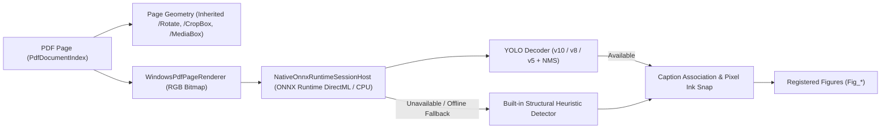

# ONNX Runtime & Hybrid Detection Pipeline

Specification for AppData ONNX Runtime provisioning, YOLO model decoders, native library isolation, and hybrid PDF/visual fallback heuristics.

---

## 1. Runtime Management (`runtime`)

Native runtime libraries (`onnxruntime.dll`, `onnxruntime_providers_shared.dll`, `DirectML.dll`) and `doclayout_yolo_docstructbench_imgsz1024.onnx` live in `--app-data` (`<appData>/runtime/onnxruntime/win-x64/1.20.1/` and `<appData>/models/`), outside the CLI executable.

- **Auto-Install**: When missing at inference time (unless `--offline` or `MELOMG_OFFLINE=1`), `melomg` installs `directml` (`1.20.1` + DirectML `1.15.2`) using a 5-minute combined download deadline and disk-streamed SHA-256 hashing.
- **Integrity & Atomic Rollback**:
  - Validates `MZ` PE headers, ONNX model protobuf structure (`OnnxProtobufEngine`), and optional pinned SHA-256 digests (`ExpectedDirectMlRuntimeSha256`, `ExpectedDirectMlRedistSha256`, `ExpectedCpuRuntimeSha256`, `ExpectedPretrainedModelSha256`).
  - Backs up any pre-existing runtime directory and `manifest.json` before swapping staged files; restores prior state if native load verification or pretrained model download fails.
  - `runtime status` verifies every DLL's file length and SHA-256 against `manifest.json`, reporting `InstalledProvider = "corrupt"` on mismatch.
- **Native Handle Isolation (`NativeOnnxRuntimeSessionHost`)**: Synchronizes `DllImportResolver` state via immutable snapshots, tracks all resolved auxiliary native handles for cleanup during `uninstall`, preserves host DLL search paths (`AddDllDirectory` without overwriting process default search dirs), and guards cached `InferenceSession` lifetime with `ReaderWriterLockSlim`.

---

## 2. Detection Pipeline Architecture

---

## 3. YOLO Tensor Decoding & Custom Models

`NativeOnnxRuntimeSessionHost.DecodeYoloOutput` auto-detects output tensor layout with strict bounds checks:
1. **YOLOv10 / DocLayout-YOLO `[1, N, 6]`**: `[x1, y1, x2, y2, score, classId]` (bypassed when caller/model specifies a 1-class profile so 1-class YOLOv5 `[1, N, 5+1]` decodes accurately).
2. **YOLOv8 / v11 `[1, 4 + C, anchors]`**: Transposed class-probability channels decoded with bounds-checked indexing and NMS.
3. **YOLOv5 `[1, N, 5 + C]`**: Center-size boxes, objectness confidence, class probabilities, and NMS.

**Class Label Resolution**: Embedded ONNX metadata (`melomg_classes`, `names`) takes priority; when absent, caller-supplied `OnnxModelProfile.Classes` is retained in session cache before falling back to the 10-class `DocStructBench` schema.

---

## 4. PDF Parsing & Geometric Guarantees

- **Page Tree**: Inherits `/CropBox`, `/MediaBox`, and `/Rotate` (`0`, `90`, `180`, `270`) along parent `/Pages` chains.
- **Object Streams & Dictionaries**: Bounds-clamps `/ObjStm` offsets against decoded payload length, skips string literals and comments while scanning object boundaries, and matches exact delimited PDF dictionary keys in `ResolveSubDictionary`.
- **Text Spans & Escapes**: Decodes ISO 32000-1 octal escapes (`\ddd`) and backslash line continuations, and clusters text spans via Y-proximity bands prior to horizontal merging.
