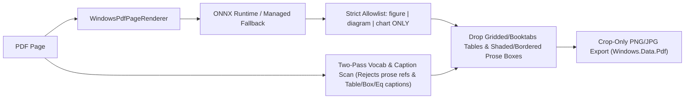

# ONNX Runtime & Image/Diagram-Only Detection Pipeline

Specification for AppData ONNX Runtime provisioning, strict image/diagram-only allowlist decoding, PDF vocabulary extraction, and structural exclusion of tables/boxes/formulas.

## 1. Runtime Management (`runtime`)

Native runtime libraries (`onnxruntime.dll`, `onnxruntime_providers_shared.dll`, `DirectML.dll`) and `doclayout_yolo_docstructbench_imgsz1024.onnx` live in `--app-data` (`<appData>/runtime/onnxruntime/win-x64/1.20.1/` and `<appData>/models/`).

- **Auto-Install**: Installs `directml` when missing unless `--offline` or `MELOMG_OFFLINE=1` is set (degrading cleanly to `managed-fallback`). Under `--json`, download progress lines are suppressed so `stderr` stays clean.
- **Pinned Integrity & Rollback**: Enforces pinned SHA-256 digests (`RequirePinnedSha256 = true` by default) against immutable NuGet packages and the pinned Hugging Face commit for `doclayout_yolo_docstructbench_imgsz1024.onnx`, validates `MZ` PE headers and ONNX protobuf structure, and rolls back on load failure.
- **Dynamic Input Size & Metadata Priority**: `OnnxProtobufEngine` infers input dimensions from `imgsz<N>` filenames (e.g., `1024x1024`) when an ONNX graph uses symbolic/dynamic dims, preserves `EmbeddedClasses` separately from fallback defaults, and prioritizes `melomg_classes` over `names` (supporting quoted JSON keys and sparse class indices).
- **Thread-Safe Native Session Lifecycle**: Auxiliary DLL handles are tracked in a lock-free `ConcurrentBag<nint>` (eliminating loader-lock AB-BA deadlocks), `SessionOptions` handles are deterministically disposed, and native handle teardown is exception-safe.

## 2. Strict Image/Diagram-Only Pipeline

- **Class Index Preservation**: `DocStructBenchClasses` indices are preserved intact during YOLO decoding so model `classId` mappings never shift; `ClassifyAndCollect` filters strictly on an allowlist (`figure`, `diagram`, `chart` and their captions) and drops `table`, `table_caption`, `isolate_formula`, `formula_caption`, `title`, `plain text`, `abandon`, and unknown classes.
- **Structural Table & Box Exclusion**:
  - `ClusterVectorRegionsGrid` drops rectangular grid tables, borderless `booktabs` rule-tables (thin rules + multi-column text rows), and bordered prose callout boxes.
  - `AugmentTensorWithRenderedVisualFeatures` rejects uniform-tint shaded prose callout boxes.
  - Candidates whose nearest aligned caption is a `Table`, `Box`, `Sidebar`, `Equation`, `Formula`, or `Algorithm` caption are discarded during ingestion.
- **Two-Pass Vocabulary, PDF Parser & Reading Order**:
  - Scans merged page text spans with `FigureNumberNormalizer` (handling `#Fig. 2.1`, 3-level hierarchical series like `1.2.3`, hyphenated prefixes like `S-1`, and Roman numerals without false sub-panel expansion), ignoring inline body-text references (`"Figure 2.1 shows..."`) and non-figure artifacts.
  - Handles multi-level `/Resources` inheritance, incremental `/ObjStm` updates by file offset, `/Info` `/Title` decoding (escaped parentheses, UTF-16BE BOM, skipping `/Outlines`), indirect `/Contents` arrays, Form XObjects with `/ProcSet [/ImageB ...]`, inline images (`BI ... ID ... EI`), and multi-line `beginbfrange` ToUnicode CMaps.
  - Multi-line textbook captions support up to 18 continuation lines with two-column gutter isolation, same-baseline caption continuation merging, and a neural `figure_caption` bounding-box recovery fallback.
  - Orders multi-figure pages using two-column vertical bands and ascending same-series figure ordinals (`FigureSequenceAnalyzer.TryParseSeriesOrdinal`), and applies text-coverage / prose-box gating in `--offline` managed-fallback mode to suppress false positives.
