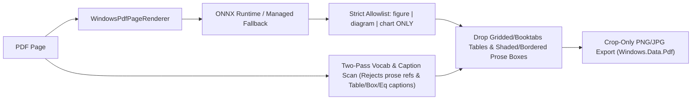

# ONNX Runtime & Image/Diagram-Only Detection Pipeline

Specification for AppData ONNX Runtime provisioning, strict image/diagram-only allowlist decoding, PDF vocabulary extraction, and structural exclusion of tables/boxes/formulas.

## 1. Runtime Management (`runtime`)

Native runtime libraries (`onnxruntime.dll`, `onnxruntime_providers_shared.dll`, `DirectML.dll`) and `doclayout_yolo_docstructbench_imgsz1024.onnx` live in `--app-data` (`<appData>/runtime/onnxruntime/win-x64/1.20.1/` and `<appData>/models/`).

- **Auto-Install**: Installs `directml` when missing unless `--offline` or `MELOMG_OFFLINE=1` is set (degrading cleanly to `managed-fallback`).
- **Atomic Rollback & Integrity**: Validates `MZ` PE headers, ONNX protobuf structure, and pinned/manifest SHA-256 digests; rolls back on load failure.

## 2. Strict Image/Diagram-Only Pipeline

- **Class Index Preservation**: `DocStructBenchClasses` indices are preserved intact during YOLO decoding so model `classId` mappings never shift; `ClassifyAndCollect` filters strictly on an allowlist (`figure`, `diagram`, `chart` and their captions) and drops `table`, `table_caption`, `isolate_formula`, `formula_caption`, `title`, `plain text`, `abandon`, and unknown classes.
- **Structural Table & Box Exclusion**:
  - `ClusterVectorRegionsGrid` drops rectangular grid tables, borderless `booktabs` rule-tables (thin rules + multi-column text rows), and bordered prose callout boxes.
  - `AugmentTensorWithRenderedVisualFeatures` rejects uniform-tint shaded prose callout boxes.
  - Candidates whose nearest aligned caption is a `Table`, `Box`, `Sidebar`, `Equation`, `Formula`, or `Algorithm` caption are discarded during ingestion.
- **Two-Pass Vocabulary Detection**: Scans merged page text spans with `FigureNumberNormalizer`, ignoring inline body-text references (`"Figure 2.1 shows..."`), extracts `VocabPrefix` + normalized `FigureNumber`, and builds `DocumentVocabulary`.
